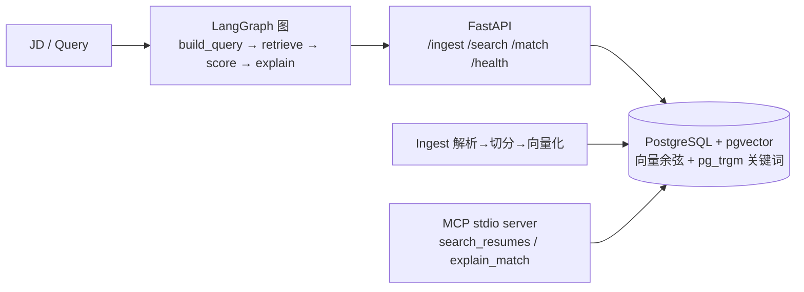

# resume-agent-demo

输入一份 JD（职位描述），从简历库中**语义检索最匹配的候选人**，并给出带引用编号的解释。
用作求职作品集：演示 RAG、混合召回、LangGraph 编排、MCP 工具与工程化测试的完整落地。

**在线演示**：https://hhao1121.cn/demo/ （Swagger：https://hhao1121.cn/demo/docs ，库内为合成数据）

[](https://github.com/hswzhigao/resume-agent-demo/actions/workflows/ci.yml)

## 架构



## 特性

- **混合召回**：向量余弦（pgvector）+ 关键词（pg_trgm / ILIKE + token 覆盖率），RRF 融合，无需调权重
- **LLM 可插拔**：OpenAI 兼容接口；**不配置 Key 也能完整跑通**（确定性启发式降级，`mode=heuristic`）
- **可选重排**：Jina/Cohere 风格 `/rerank`，不可用时静默降级
- **MCP 工具**：把 `search_resumes` / `explain_match` 暴露给 Claude Code 等 Agent
- **隐私打码**：输出默认对手机号/邮箱打码（`MASK_PII=true`），示例数据全部为合成数据
- **工程化**：pytest + Testcontainers 真库集成测试、GitHub Actions CI、Docker Compose 一键起

## 快速开始

```bash
# 1. 起数据库（pgvector）
docker compose up -d db

# 2. 安装依赖（uv，Python 3.12）
uv sync

# 3. 入库示例简历（3 份合成简历）
cp .env.example .env   # 可不填任何 Key，先用本地 hash 向量跑通
uv run python -m resume_agent_demo.cli ingest data/sample

# 4. 检索
uv run python -m resume_agent_demo.cli search "Java 高并发 后端"

# 5. JD 匹配（启发式模式；填好 .env 里的 LLM_* 后自动升级为 LLM 模式）
uv run python -m resume_agent_demo.cli match data/jd/sample_jd.md

# 6. 起 API
uv run uvicorn resume_agent_demo.api:app --reload --port 8000
# Swagger: http://localhost:8000/docs
```

### 接入你的真实简历

```bash
mkdir -p data/private   # 已在 .gitignore，不会入库
cp /path/to/your/resumes/*.pdf data/private/
uv run python -m resume_agent_demo.cli ingest data/private
```

### 接入真实模型（.env）

```ini
EMBEDDING_BASE_URL=https://你的开放平台/v1
EMBEDDING_API_KEY=sk-xxx
EMBEDDING_MODEL=text-embedding-v3
LLM_BASE_URL=https://你的开放平台/v1
LLM_API_KEY=sk-xxx
LLM_MODEL=deepseek-chat
```

> 切换向量模型后维度可能变化，执行 `ingest --reset` 重建（维度记录在 `rag_meta`，不一致会明确报错）。

## 给 Agent 用（MCP）

在 Claude Code 的 `mcpServers` 配置：

```json
{
  "resume-agent-demo": {
    "command": "uv",
    "args": ["--directory", "/绝对路径/resume-agent-demo", "run", "python", "-m", "resume_agent_demo.mcp_server"]
  }
}
```

之后即可让 Agent 调用 `search_resumes(query)` 与 `explain_match(jd)`。

## 测试

```bash
uv run pytest                        # 单测 + pgserver 真库集成测试（无需 Docker）
DATABASE_URL=... uv run pytest       # 连接已有 pgvector（CI 模式）
PGVECTOR_IMAGE=pgvector/pgvector:pg16 uv run pytest  # 强制用 Testcontainers
uv run ruff check .                  # lint
```

## 检索评测

评测集 `data/eval/queries.jsonl`（12 条，含期望命中人），指标 hit@k / MRR：

```bash
uv run python scripts/eval.py -k 3
```

当前基线（本地 hash 向量 + 关键词路）：**hit@3 = 100%，MRR = 0.958**。
接入真实 embedding 模型后重跑即可对比——这是「模型评测」闭环的起点。

## 可观测

配置 `.env` 里的 `LANGFUSE_*` 后，每次 `/match` 与 `explain_match` 自动上报 trace
（输入 JD、检索词、评分模式、耗时、候选列表）；未配置时为 no-op。

## 设计说明

见 [docs/design.md](docs/design.md)。关键取舍：

| 决策 | 理由 |
| --- | --- |
| PostgreSQL + pgvector | 生产最常用的向量方案，兼顾岗位面试要求 |
| pg_trgm 做关键词路，缺失自动降级 ILIKE | 中文无分词依赖；裁剪版发行版也能跑 |
| RRF 融合 | 排名融合免调参，可独立单测 |
| 本地 hash 向量降级 | 离线可跑、CI 无密钥；仅开发用，质量有限 |
| 启发式 LLM 降级 | 图结构始终可验证，Key 即插即用 |

## Roadmap

- [x] Langfuse 接入：trace（hit@k / MRR 评测已内置 scripts/eval.py；忠实度评测待补）
- [ ] 简历 PDF 真实样例的解析增强（OCR fallback）
- [ ] IVFFlat / HNSW 索引（数据量 10 万级再启用）
- [ ] Dify 版本的知识库应用对照实现

## License

MIT
